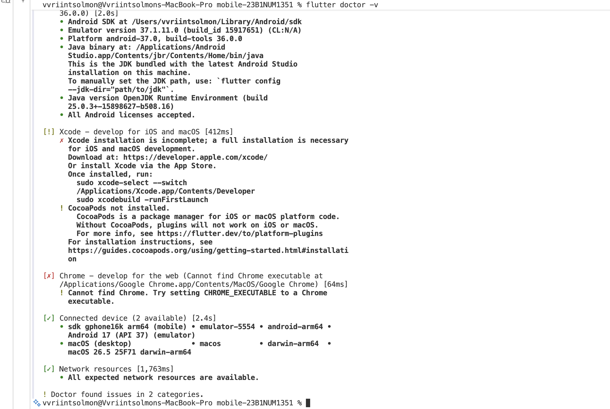
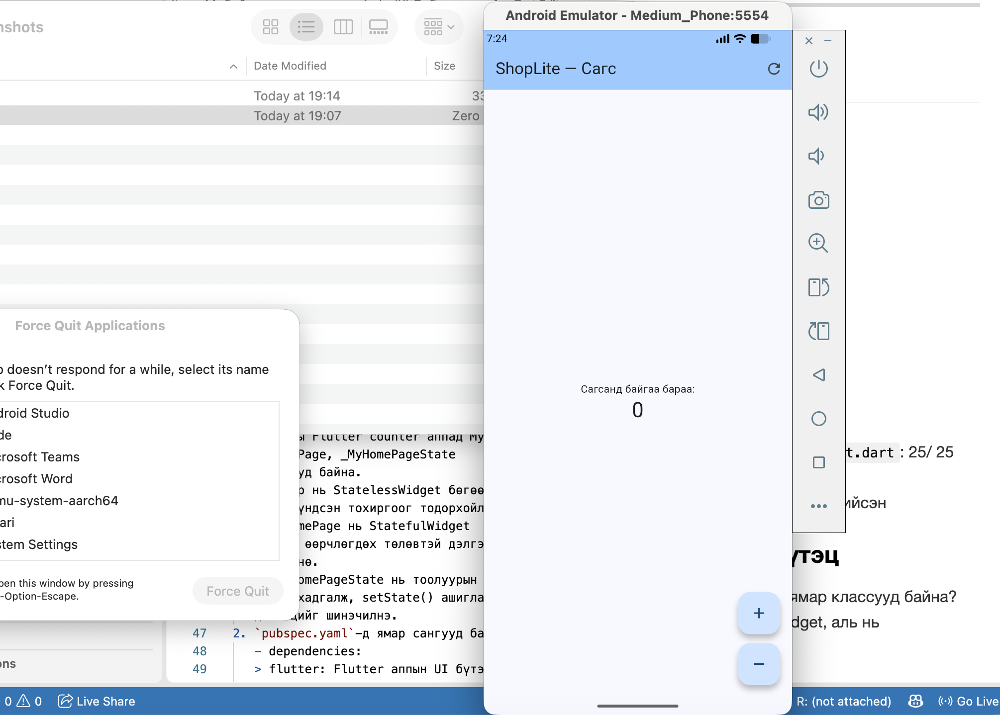

# ShopLite — Мобайл апп хөгжүүлэлт (Flutter)

**Нэр:** Үүрийнцолмон 
**Оюутны код:** 23B1NUM1351

Энэ репозиторид 6 долоо хоногийн турш бүх лабораторийн кодоо хадгална.

```
├── README.md          ← энэ файл (доорх хэсгүүдийг бөглөнө)
├── screenshots/       ← дэлгэцийн зураг
├── lab1_dart/         ← Лаборатори 1: Dart дасгал
└── shoplite/          ← Лаборатори 1-д `flutter create`-оор үүсгэнэ
```

## Код хадгалах (лаборатори бүрийн төгсгөлд)

```bash
git add .
git commit -m "Lab 1: Dart модель, shoplite апп"
git push
git tag v0.1            # Лаб 1 → v0.1, Лаб 2 → v0.2, ...
git push origin v0.1
```

Push хийсний дараа GitHub дээрх **Actions** табаас автомат тестийн үр дүнг (ногоон ✓ / улаан ✗) харна.
`lab1_dart/test/` болон `.github/` хавтасны файлуудыг **өөрчлөхгүй**.

---

## Лаборатори 1




### lab1_dart

- `dart test test/lab1_test.dart`: 25/ 25
- Бонус B1 (`dart test test/bonus_test.dart`): хийсэн

### D2. Төслийн бүтэц

1. `lib/main.dart`-д ямар классууд байна? Аль нь StatelessWidget, аль нь StatefulWidget вэ?
   > Анхны Flutter counter аппад MyApp, MyHomePage, _MyHomePageState классууд байна.
   - MyApp нь StatelessWidget бөгөөд аппын үндсэн тохиргоог тодорхойлно.
   - MyHomePage нь StatefulWidget бөгөөд өөрчлөгдөх төлөвтэй дэлгэцийг төлөөлнө.
   - _MyHomePageState нь тоолуурын утгыг хадгалж, setState() ашиглан дэлгэцийг шинэчилнэ.
2. `pubspec.yaml`-д ямар сангууд байна?
   - dependencies:
   > flutter: Flutter аппын UI бүтээх үндсэн SDK.
   cuperrtino_icons: ^1.0.8 — iOS загварын icon ашиглах сан.
   - dev_dependencies:
   > flutter_test: Flutter аппын тест бичих, ажиллуулах сан.
   flutter_lints: ^6.0.0 — Dart болон Flutter кодын бичиглэлийн дүрмийг шалгах сан.

3. `android/` хавтас юунд хэрэгтэй вэ? Та ихэвчлэн аль хавтсанд код бичих вэ?
   >android/ хавтас нь Flutter аппыг Android төхөөрөмж дээр build хийх, ажиллуулахад шаардлагатай тохиргоо болон платформын файлуудыг агуулна.
   Аппын үндсэн Dart кодыг ихэвчлэн lib/ хавтсанд, тестүүдийг test/ хавтсанд бичнэ.

### D4. Hot reload ба hot restart

| Өөрчлөлт | Hot reload (r) | Hot restart (R) |
|---|---|---|
| AppBar-ийн гарчгийг өөрчлөх | өөрчлөгдсөн| шинэ гарчиг харагдана|
| seed өнгийг солих | солигдсон| солигдсон|
| `int _count = 0;` → `= 5` | тоо 3 хэвээр| тоо 5 болсон|
| `main()` дотор `print('start');` нэмэх | хэвлэгдээгүй |хэвлэгдсэн|

**Дүгнэлт:** аль тохиолдолд тоолуурын утга (state) хадгалагдсан бэ? Яагаад?
> Hot reload хийхэд Flutter одоо байгаа State объектыг хадгалдаг учраас тоолуурын утга өөрчлөгдөөгүй. Харин hot restart нь аппыг дахин эхлүүлж, State объектыг шинээр үүсгэдэг.